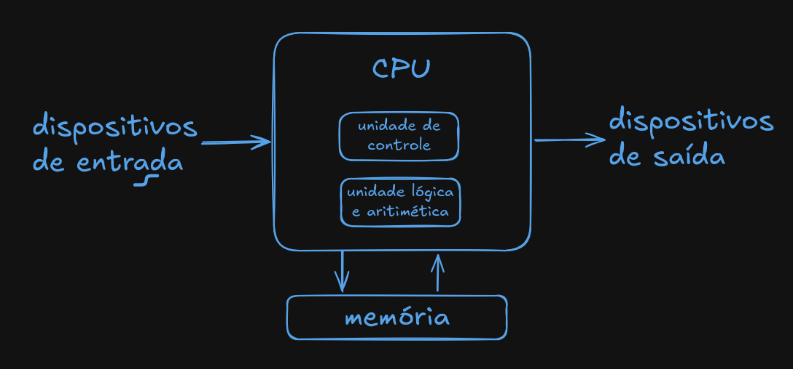
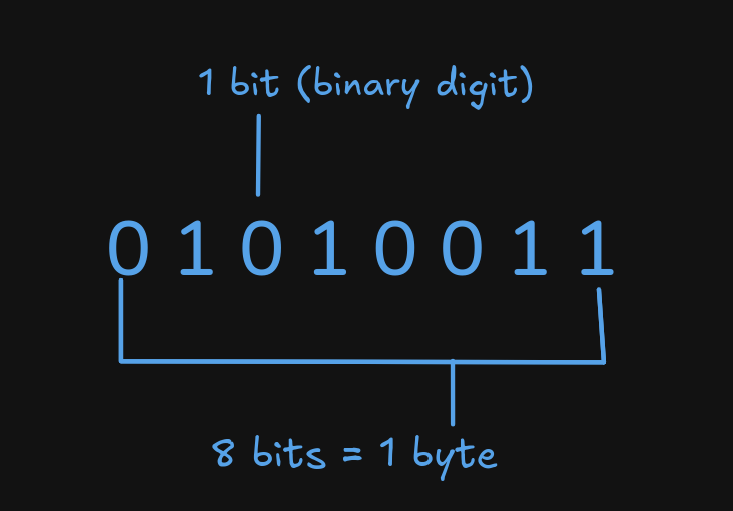

# Fundamentos da linguagem assembly

## 1. Arquitetura de Von Neumann



A Arquitetura de von Neumann é um modelo de computador digital de programa armazenado que guarda dados e instruções no mesmo espaço de memória.

## 1.2 Dados binários



Com entrada e saída pensamos diretamente em dados binários. Binário se refere a dados com 2 possibilidades apenas.

## 1.3 Assembly

Assembly é uma linguagem de baixo nível que representa instruções de máquina através de nomes simbólicos.

<div class="grid grid-cols-2 gap-8">

<div>

**Assembly**

- Nomes para instruções
- Nomes para registradores
- Rótulos para endereços
- Dados como números

</div>

<div>

```nasm
section .text

    global _start

_start:
    mov rax, 60
    mov rdi, 0
    syscall
```

</div>

</div>

## 1.4 Montador (assembler)

O montador transforma o código Assembly em um arquivo objeto contendo o código de máquina e informações necessárias para a etapa de ligação.

<div class="grid grid-cols-2 gap-8">

<div>

**Montador**

- Lê o código Assembly
- Converte instruções para código de máquina
- Produz um arquivo objeto
- Mantém símbolos necessários para o ligador

</div>

<div>

```bash
➜ nasm -f elf64 ok.asm
```

Isso produz:

```bash
ok.o
```

</div>

</div>

## 1.5 Ligador (linker)

O ligador combina os arquivos objeto e resolve símbolos e endereços, produzindo o executável final.

<div class="grid grid-cols-2 gap-8">

<div>

**Ligador**

- Combina arquivos objeto
- Resolve símbolos
- Organiza as seções
- Gera o executável

</div>

<div>

```bash
➜ ld ok.o -o ok
```

Resultado:

```text
ok
```

</div>

</div>
