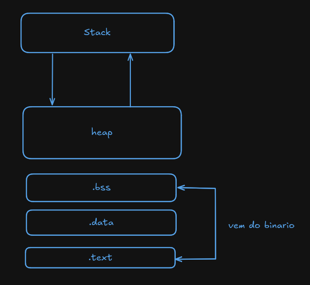

# Primeiro programa em asm

## 2 Hello

Nosso primeiro código será um simples `Hello people` no terminal, segue o código abaixo
Nosso primeiro código será um simples `Hello people` no terminal, segue o código abaixo

```nasm
section .data

msg: db "Hello people", 10

len: equ $-msg


section .text
    global _start


_start:
    mov rax, 1
    mov rdi, 1
    mov rsi, msg
    mov rdx, len
    syscall


_end:
    mov rax, 60
    mov rdi, 0
    syscall
```

Muita coisa eu sei, vamos destrinchar isso pedaço por pedaço ok. Vamo lá

## 2.1 Layout da memoria



### Dados não iniciados (_block starting symbol_)

Onde moram os dados não inicializados e análogo (equivalente) à variáveis não iniciados

```nasm
section .bss
```

### Dados iniciados

Onde moram os dados inicializados e análogo à incialização de variáveis e definições de constantes (pré-processadas).

```nasm
section .data
```

### Dados inalteráveis (_read only_)

Como próprio nome diz, são dados que não mudam, apenas leitura, e são geralmente integrados ao segmento `.text` do binário

```nasm
section .rodata
```

### Código do programa

É onde fica toda lógica do programa de fato

```nasm
section .text
```

## 2.2 Explicando código

```nasm
msg: db "Hello people", 10
len: equ $-msg
```

Definimos uma váriavel `msg` e uma constante `len`, os `:` após `msg` ou `len` é opcional

`db` é uma pesudoinstrução que significa _define bytes_, ele é usado para definir os nossos bytes

> **10** significa quebra de linha em ASCII, poderíamos escrever tudo em ASCII se quiséssemos

`equ` é outra pesudoinstrução que faz referência à outro dado existnte, a flag `$-` indica qual outra pseusoinstrução iremos usar, no nosso caso `msg`

> [!NOTE]
> Importante saber que no nosso caso o len contém o tamanho de **13** (12 para frase, 1 para quebra de linha) bytes, porém se nossa mensagem fosse "hello", nosso len escrito da mesma maneira teria o tamanho de **6** (5 para palavra, 1 para quebra de linha)

---

```nasm
global _start
```

A diretiva `global` nos diz o ponto inicial do programa, por baixo dos panos o nasm exporta o símbolo _start, e depois o ld procura esse símbolo

---

```nasm
_start:
    mov rax, 1
    mov rdi, 1
    mov rsi, msg
    mov rdx, len
    syscall
```

A intrução `mov registrador, valor` move o valor (depois da vírgula) para o registrador, criando uma instrução

`mov rax, 1` | move 1 no registrador rax, que chama o sistema de _sys_write_ (escrita)
`mov rdi, 1` | move 1 no registrador rdi , que chama o descitor de arquivos 1 _stdout_

`mov rsi, msg` | é um ponteiro que aponta para nossa string em memória
`mov rdx, len` | é a constante com o tamanho da string

`syscall` | invoca a chamada de sistema com os dados nos registradores

---

```nasm
_end:
    mov rax, 60
    mov rdi, 0
    syscall
```

`mov rax, 60` | move 60 no registrador rax, que chama o sistema de _sys_exit_ (encerra)
`mov rdi, 0` | move 0 no registrador rdi , que define o retorno do nosso código (0 para sucesso)

`syscall` | invoca a chamada de sistema com os dados nos registradores
